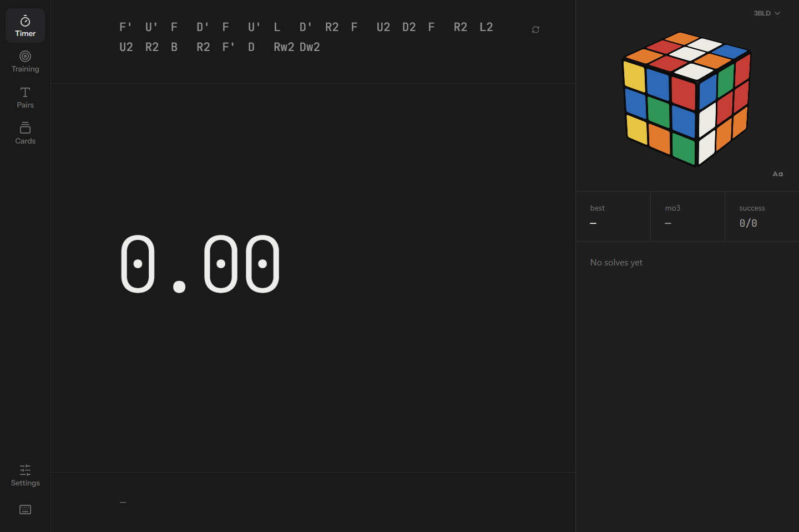

# BlindSolve

BlindSolve is a web app for practising 3×3 blindfolded cube solving (3BLD).
Time your solves, review them, and practise remembering letter pairs and
recognising targets.

[](https://blindsolve.com)



## Features

- A solve timer with memo and execution splits
- Reconstruction to review a solve
- Letter-pair words and flashcards
- Recall, tracing, execution and guided-solve practice
- Target Recognition using the colours of scrambled pieces
- Saved history, backups and recovery

## Built with

React, TypeScript, Vite, Tailwind CSS and cubing.js. Optional cloud features
use Supabase.

## Running locally

Install Node.js 24.12 or newer and npm. From the repository folder:

```sh
cd web
npm ci
npm run dev
```

Open the address printed in the terminal, usually `http://localhost:5173`.

The timer, training, letter pairs, flashcards, history and backups work
without Supabase. No account or environment file is needed; your saved data
stays in this browser.

Sign-in, cloud sync and feedback are optional. They need a separate Supabase
project. Copy `web/.env.example` to `web/.env.local` and use your own project
credentials. Never connect local development to production data.

To build the app, run `npm run build` from `web/`. The files go into `web/dist/`.

## Testing

From `web/`:

```sh
npm test
npm run lint
npm run typecheck
```

## License

BlindSolve's original code is licensed under the [MIT License](LICENSE).
See [third-party notices](web/public/THIRD-PARTY-NOTICES.txt) for software,
assets and data with separate terms.
