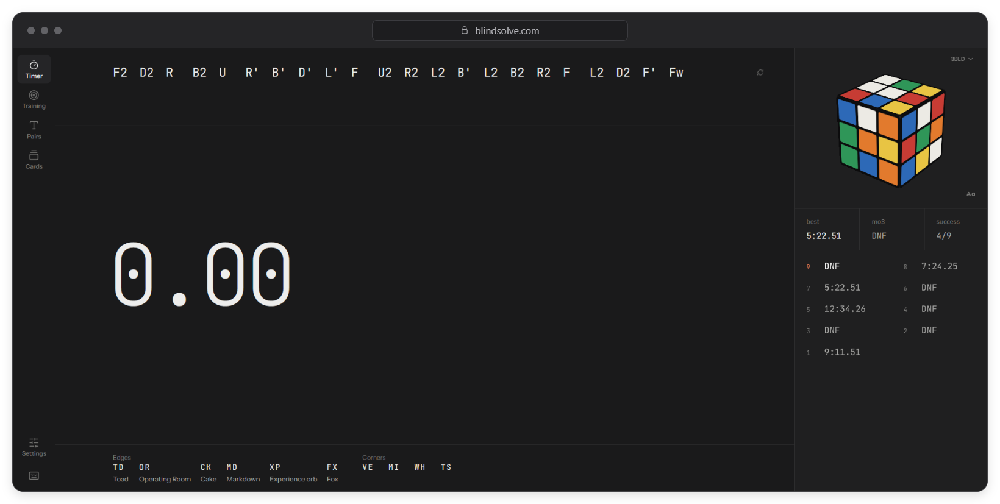

# BlindSolve

BlindSolve is a web app for practising 3×3 blindfolded cube solving (3BLD).
Time your solves, review them, and practise remembering letter pairs and
recognising targets.

[](https://blindsolve.com)

<p align="center">
  
</p>

## Features

- A solve timer with memo and execution splits
- Reconstruction to review a solve
- Letter-pair words and flashcards
- Recall, tracing, execution and guided-solve practice
- Target Recognition using the colours of scrambled pieces
- Saved history, backups and recovery

## Built with

React, TypeScript, Vite, Tailwind CSS and cubing.js. Optional cloud features
use Supabase.

## Running locally

Install Node.js 24.12 or newer and npm. From the repository folder:

```sh
cd web
npm ci
npm run dev
```

Open the address printed in the terminal, usually `http://localhost:5173`.

The timer, training, letter pairs, flashcards, history and backups work
without Supabase. No account or environment file is needed; your saved data
stays in this browser.

<details>
<summary>Optional cloud setup</summary>

Use a separate Supabase project, apply `supabase/migrations/` and deploy the
functions in `supabase/functions/`. Copy `web/.env.example` to `web/.env.local`
with that project's public URL and key. Never use production data locally.

For Google sign-in, enable its Auth provider and allow your development redirect
URL. WCA sign-in needs HTTPS and the callback
`<SUPABASE_URL>/functions/v1/wca-oauth/callback`.

The Edge functions require `APP_URL`, `SUPABASE_URL` and
`SUPABASE_SERVICE_ROLE_KEY`; WCA also needs `WCA_CLIENT_ID` and
`WCA_CLIENT_SECRET`. Keep service-role and OAuth secrets on the server, never
in `VITE_` variables.

</details>

To build the app, run `npm run build` from `web/`. The files go into `web/dist/`.

## Testing

From `web/`:

```sh
npm test
npm run lint
npm run typecheck
```

For isolated Auth, REST and Storage security checks, start a disposable local
Supabase stack with these migrations, then run
`node web/tests/infrastructure/provider.mjs` from the repository root. Set
`LOCAL_SUPABASE_URL` (HTTP loopback), `LOCAL_SUPABASE_CONTAINER` (the local Docker
database container), and `LOCAL_SUPABASE_JWT_SECRET` (the disposable stack secret).
Never supply hosted credentials. CI runs this suite against a fresh local stack.

For interactive Admin development on that same disposable stack,
`node web/scripts/seed-admin-local.mjs` adds synthetic accounts, activity and
feedback and prints a one-time local sign-in link. Set `LOCAL_APP_URL` to your
local Vite address (default `http://127.0.0.1:5173`) and allow its `/admin` redirect
in the local Auth configuration. Configure Vite with the local API URL and
public anon key. The seed command is repeatable; use only a disposable database.

## License

BlindSolve's original code is licensed under the [MIT License](LICENSE).
See [third-party notices](web/public/THIRD-PARTY-NOTICES.txt) for software,
assets and data with separate terms.
